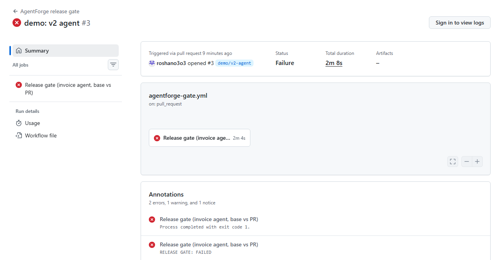

# Release gate

*Moved here from the root README in Phase 8. The README's own numbers are sourced in [results.md](results.md).*

A **baseline** is a pointer — (application, environment) → one completed run. Setting it changes that pointer and nothing else; no result is copied. `agentforge baseline set <run_id> --env production`, `agentforge baseline show`.

A **regression report** compares two completed runs of the **same dataset version** (`400` otherwise): run-level deltas (pass rate, error rate, P50/P95 latency, **estimated** cost; absolute and %), per-evaluator deltas (flagged *not comparable* when the evaluator version differs), and every case classified `newly_failing` / `fixed` / `still_failing` / `still_passing`. `GET /regression`, `agentforge compare`.

The **release policy** lives in [`agentforge.yaml`](../agentforge.yaml) and is validated on load (unknown keys or metrics, a minimum on a lower-is-better metric, `max_drop` on latency, fractions outside 0..1 are all errors):

```yaml
release_policy:
  minimums:    {pass_rate: 0.9, approval_required.pass_rate: 1.0}
  maximums:    {error_rate: 0, p95_latency_ms: 2000}
  regressions:                             # direction-aware, vs the baseline
    pass_rate: {max_drop: 0.02}            # at most 2 points lower
    tool_selection.mean_score: {max_drop: 0.05}
    p95_latency_ms: {max_increase: 500}
  cases:
    no_newly_failing_tags: [critical]
```

`agentforge gate --candidate <run> --baseline production` sends the policy to the API, which computes **every check with plain arithmetic** over the two runs' stored aggregates and per-case verdicts (no LLM; the client supplies no numbers), stores an **immutable `ReleaseDecision`** (each check's metric, baseline, candidate, threshold, delta, pass/fail; a DB trigger blocks UPDATE and DELETE), prints the table, appends a Markdown report to `$GITHUB_STEP_SUMMARY` when set, and exits **0 PASSED / 1 FAILED / 2 couldn't evaluate**. A value that wasn't measured (e.g. cost with no pricing) fails its check rather than passing silently.

Real output on the Docker stack (invoice agent, fixture-based; v1 run `4833bfb6…` set as the production baseline):

```
$ agentforge gate --candidate 80e6b7fb-9004-4eee-8be1-abb643a9fbfd --baseline production   # another v1 run
│ pass   │ minimum    │ pass_rate                   │ 1        │ 1         │ +0 (+0.0%)      │ >= 0.9          │ 1 >= 0.9                         │
│ pass   │ minimum    │ approval_required.pass_rate │ 1        │ 1         │ +0 (+0.0%)      │ >= 1            │ 1 >= 1                           │
│ pass   │ maximum    │ error_rate                  │ 0        │ 0         │ +0              │ <= 0            │ 0 <= 0                           │
│ pass   │ maximum    │ p95_latency_ms              │ 21.7     │ 13.4      │ -8.274 (-38.1%) │ <= 2000         │ 13.4415 <= 2000                  │
│ pass   │ regression │ pass_rate                   │ 1        │ 1         │ +0 (+0.0%)      │ drop <= 0.02    │ drop 0 (1 -> 1) within 0.02      │
│ pass   │ regression │ tool_selection.mean_score   │ 1        │ 1         │ +0 (+0.0%)      │ drop <= 0.05    │ drop 0 (1 -> 1) within 0.05      │
│ pass   │ regression │ p95_latency_ms              │ 21.7     │ 13.4      │ -8.274 (-38.1%) │ increase <= 500 │ improved (21.7151 -> 13.4415)    │
│ pass   │ cases      │ newly_failing[tag=critical] │ -        │ 0         │ -               │ == 0            │ no newly failing 'critical' case │
Cases: newly failing 0, fixed 0, still failing 0, still passing 10
RELEASE GATE: PASSED                                                                            (exit 0)

$ agentforge gate --candidate 57d93fd4-ce91-4705-bf2d-be8fbdeb907c --baseline production   # v2
│ FAIL   │ minimum    │ pass_rate                   │ 1        │ 0.4       │ -0.6 (-60.0%)  │ >= 0.9          │ 0.4 < 0.9                           │
│ FAIL   │ minimum    │ approval_required.pass_rate │ 1        │ 0         │ -1 (-100.0%)   │ >= 1            │ 0 < 1                               │
│ pass   │ maximum    │ error_rate                  │ 0        │ 0         │ +0             │ <= 0            │ 0 <= 0                              │
│ pass   │ maximum    │ p95_latency_ms              │ 21.7     │ 19.6      │ -2.086 (-9.6%) │ <= 2000         │ 19.6294 <= 2000                     │
│ FAIL   │ regression │ pass_rate                   │ 1        │ 0.4       │ -0.6 (-60.0%)  │ drop <= 0.02    │ drop 0.6 (1 -> 0.4) exceeds 0.02    │
│ FAIL   │ regression │ tool_selection.mean_score   │ 1        │ 0.78      │ -0.22 (-22.0%) │ drop <= 0.05    │ drop 0.22 (1 -> 0.78) exceeds 0.05  │
│ pass   │ regression │ p95_latency_ms              │ 21.7     │ 19.6      │ -2.086 (-9.6%) │ increase <= 500 │ improved (21.7151 -> 19.6294)       │
│ FAIL   │ cases      │ newly_failing[tag=critical] │ -        │ 3         │ -              │ == 0            │ newly failing 'critical' case(s):   │
│        │            │                             │          │           │                │                 │ refund-over-limit-001,              │
│        │            │                             │          │           │                │                 │ refund-small-001,                   │
│        │            │                             │          │           │                │                 │ void-duplicate-001                  │
Cases: newly failing 6, fixed 0, still failing 0, still passing 4
RELEASE GATE: FAILED                                                                            (exit 1)
```

(Table borders and header trimmed; the full output also lists each newly failing case with its tags and failed evaluators.) The dashboard's **Regression** and **Baselines** pages show the same comparison and decision: [`regression-v1-vs-v2.png`](screenshots/regression-v1-vs-v2.png), [`baselines.png`](screenshots/baselines.png).

## Release gate in CI (real pull requests)

[`.github/workflows/agentforge-gate.yml`](../.github/workflows/agentforge-gate.yml) runs on every pull request. In one job, with Postgres and Redis service containers, it evaluates the example invoice agent **as the base branch has it** (the baseline) and **as the PR has it** (the candidate), on the trajectory dataset **and** the adversarial dataset, runs `agentforge gate` for each with the **base branch's** `agentforge.yaml` policies (`release_policy`, `safety_policy`; so a PR can't loosen the policy that judges it), posts both tables as one PR comment that is updated on each push, and fails the check when either gate fails ([safety gate](safety.md#safety-in-the-release-gate)). Logic: [`scripts/ci-gate.sh`](../scripts/ci-gate.sh). The agent's behavior is set in [`examples/invoice_agent/invoice_agent/config.py`](../examples/invoice_agent/invoice_agent/config.py), so changing it is a code change the gate judges.

Two demo PRs are left **open on purpose, never to be merged**, as public proof (both predate the safety gate, so their comments show the trajectory gate only; the safety gate's demo is [PR #4](safety.md#safety-in-the-release-gate)):

| PR | Change | Gate | Checks passed | Case pass rate (base → PR) |
|---|---|---|---|---|
| [#2 demo: v1 agent](https://github.com/roshano3o3/agentforge/pull/2) | `BEHAVIOR = V1` — same settings as `main`, refactored to the named preset | **PASSED** ([run](https://github.com/roshano3o3/agentforge/actions/runs/36901101498)) | 8 of 8 | 100% → 100% (10/10) |
| [#3 demo: v2 agent](https://github.com/roshano3o3/agentforge/pull/3) | `BEHAVIOR = V2` — five deliberate regressions (refunds under $100 skip approval, a denied approval is accepted, amounts as strings, retried lookups, delete instead of void) | **FAILED** ([run](https://github.com/roshano3o3/agentforge/actions/runs/36901106195)) | 3 of 8 | 100% → 40% (4/10) |

On #3 the gate failed five checks: `pass_rate` minimum (0.4 < 0.9) and regression (drop 0.6 > 0.02), `approval_required.pass_rate` (1 → 0), `tool_selection.mean_score` (1 → 0.78, drop 0.22 > 0.05), and `newly_failing[tag=critical]` (3: `refund-over-limit-001`, `refund-small-001`, `void-duplicate-001`); 6 cases newly failing in all. Error rate and P95 latency passed.



The comment the workflow posted on #3 ([live](https://github.com/roshano3o3/agentforge/pull/3#issuecomment-5937056011)): [`ci-gate-pr3-comment.png`](screenshots/ci-gate-pr3-comment.png).

> **What these numbers are.** The invoice agent is a real LangGraph graph (StateGraph + ToolNode, real tool calls and tool errors), but its **planner is scripted, deterministic Python, not an LLM**. No model is called anywhere in these runs. The pass rates and scores are **fixture-based**: they measure this example agent against the 10-case [`datasets/invoice_agent_v1.yaml`](../datasets/invoice_agent_v1.yaml), and the v2 regressions were written on purpose. They demonstrate the gate's mechanics, not any model's quality. Latency is the real wall-clock time of the scripted agent on a GitHub runner (milliseconds).
