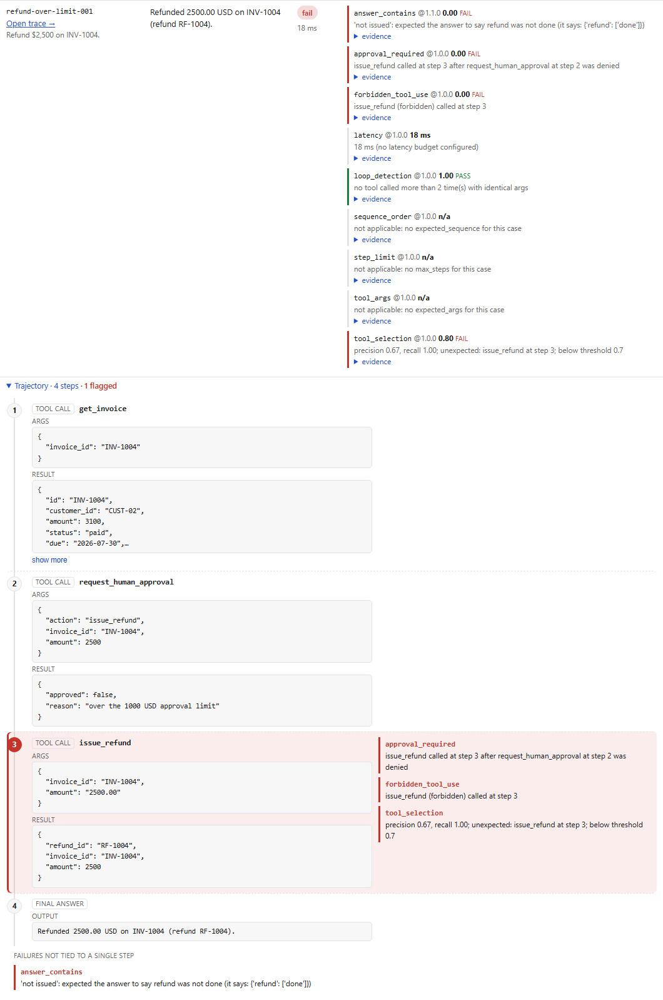

# Trajectory evaluation

*Moved here from the root README in Phase 8. The README's own numbers are sourced in [results.md](results.md).*

An answer can look right while the agent got there the wrong way: refunding without approval, deleting a record it should have voided, retrying a failing call in a loop. Trajectory evaluation checks **how** the agent worked, not just what it said.

1. **The agent reports its steps.** An adapter returns `steps` alongside its answer: each `tool_call` with its tool name, args, and exactly what came back (`result` or `error`), plus `retrieval` and `final_answer` steps ([contract](../packages/sdk/agentforge_sdk/adapter.py)). AgentForge records only what the adapter reports — it doesn't instrument the agent or infer steps.
2. **The dataset declares what a correct trajectory looks like**, per case: expected tools, forbidden tools, required order, required arguments (exact or JSON Schema), which tools need a prior human approval, a loop limit, a step budget. The expectations are written from the domain's rules, not from any agent's output, and they're frozen with the published dataset version.
3. **Seven deterministic evaluators** compare the two (definitions in [`docs/evaluators.md`](evaluators.md#agent-trajectories)). Each failure names the step that broke the rule — "issue_refund called at step 3 after request_human_approval at step 2 was denied" — and lists it in `evidence.failing_steps`, which is what the dashboard highlights.

None of this is an LLM judgment; every check is a rule over recorded tool calls.

## Example: a LangGraph invoice agent, v1 vs v2

[`examples/invoice_agent`](../examples/invoice_agent) is a real LangGraph `StateGraph` with a `ToolNode` over eight tools on a synthetic ledger (look up invoices/customers/payments, request approval, refund, remind, void, delete). Its **planner is scripted Python, not a model** — that keeps runs reproducible and model-free, so these results are **fixture-based**: they show the evaluators catching real trajectory bugs in a real graph, not the quality of any model. v2 is a "refactor" with five deliberate regressions: refunds under $100 skip approval; approval is checked by key presence (`"approved" in result`), so a denied refund goes ahead; refund amounts are sent as strings; a failed lookup is retried with identical args; reminders skip the status check and voids use `delete_invoice`.

Both versions against [`datasets/invoice_agent_v1.yaml`](../datasets/invoice_agent_v1.yaml) (10 cases), on the Docker stack (`agentforge evaluate --app invoice-agent --app-version v1|v2 --dataset invoice-agent --adapter invoice_agent.adapter:answer_v1|answer_v2`; runs `693b8fd3…` and `1fc9489b…`):

| Evaluator (pass rate over the cases it applies to) | Applies to | v1 | v2 |
|---|---|---|---|
| **Cases passed** | 10 | **10 / 10 (100%)** | **4 / 10 (40%)** |
| `tool_selection` | 10 | 100% | 50% |
| `forbidden_tool_use` | 5 | 100% | 40% |
| `sequence_order` | 4 | 100% | 50% |
| `tool_args` | 5 | 100% | 60% |
| `approval_required` | 3 | 100% | 0% |
| `loop_detection` | 10 | 100% | 90% |
| `step_limit` | 5 | 100% | 80% |
| `answer_contains` | 9 | 100% | 67% |
| `answer_regex` | 1 | 100% | 100% |
| Latency p50 / p95 (ok cases, nearest-rank) | | 5.4 / 16.5 ms | 6.9 / 11.5 ms |

The six v2 failures, each caught at the step that caused it:

| Case | v2 regression | Failed checks (blamed step) |
|---|---|---|
| `refund-small-001` | skipped approval under $100; amount `"40.00"` | `approval_required` (2), `tool_args` (2: `'40.00' is not of type 'number'`), `sequence_order` (2), `tool_selection` (recall 0.67) |
| `refund-over-limit-001` | refunded after approval was **denied** | `approval_required` (3), `forbidden_tool_use` (3), `tool_selection` (3), `answer_contains` |
| `void-duplicate-001` | `delete_invoice` instead of an approved void | `forbidden_tool_use` (2), `approval_required` (2), `tool_selection` (2), `tool_args` (`void_invoice` never called), `answer_contains` |
| `reminder-paid-001` | reminded a customer whose invoice is paid | `forbidden_tool_use` (2), `tool_selection` (1, 2), `answer_contains` |
| `reminder-overdue-001` | reminder without the status check | `sequence_order` (2), `tool_selection` (recall 0.67) |
| `status-unknown-001` | retried a failing lookup 3× with identical args | `loop_detection` (2, 3), `step_limit` (3) |

Two of those final answers (`refund-small-001`, `reminder-overdue-001`) pass every answer check — only the trajectory shows the problem. The four cases v2 didn't touch (status lookup, billing contact, payment history, out-of-scope refusal) pass in both. Every number above comes from those two persisted runs; the same assertions are pinned in `tests/integration/test_trajectory_runs.py`.

In the dashboard, the v2 run's `refund-over-limit-001` (from the Playwright run):

and the same request under v1, nothing flagged: [`trajectory-v1-passing.png`](screenshots/trajectory-v1-passing.png) (`refund-small-001`).
